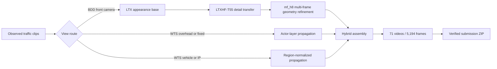

<div align="center">

# GeoRoute

### Training-Free Hybrid Inference for Traffic Future-Frame Prediction

[](https://www.aicitychallenge.org/)
[](#results)
[](#results)
[](#installation)
[](https://github.com/Lightricks/LTX-Video)

**[Overview](#overview) | [Quick Start](#quick-start) | [Reproduction](#reproduction-modes) | [Results](#results) | [Verification](#verification)**

</div>

GeoRoute is the complete inference pipeline behind our AI City Challenge 2026
Track 5 submission. It combines an LTXHF-T55 generative base, multi-frame
geometry refinement for BDD front-camera videos, and deterministic motion
specialists for WTS traffic-camera views. The system is training-free: no
generator weights are fine-tuned.

> [!IMPORTANT]
> A Git clone contains all pipeline code, validated settings, test indexing,
> source-selection reports, and SHA-256 hashes for the official submission.
> The challenge input videos and the archived BDD diffusion outputs are not
> redistributed in Git because of access restrictions and size. See
> [Reproducibility Scope](#reproducibility-scope) before claiming an exact
> `73.2843` reproduction.

## Results

Our submitted system ranked **5th** on the official full-test leaderboard.

| Final score | PSNR | SSIM | LPIPS ↓ | CLIP ↑ | FID ↓ | FVD ↓ |
|---:|---:|---:|---:|---:|---:|---:|
| **73.2843** | **19.7360** | **0.6472** | **0.2942** | **0.9454** | **33.6081** | **29.3483** |

The same route previously scored `69.3815` on the provisional public subset.
The table above reports its later official full-test evaluation.

## Overview



The `T55` stage transfers high-frequency residuals from a traffic-prompt LTX
donor with strength `0.55`. The following renderer uses up to eight observed
history frames to stabilize confident static regions. Dynamic actors,
disocclusions, and unreliable projections remain supplied by the generated
base prediction.

## Quick Start

### Requirements

| Requirement | Recommended configuration |
|---|---|
| Operating system | Linux |
| Python | 3.10 |
| GPU | NVIDIA GPU with at least 24 GB VRAM |
| Reference hardware | One RTX A6000, 48 GB |
| Storage | Approximately 80 GB |
| Data | AI City Track 5 observed test clips |

### Installation

```bash
git clone https://github.com/Khangle-2006/AICITY_Track_5.git
cd AICITY_Track_5

conda create -n georoute python=3.10 -y
conda activate georoute

# Select the PyTorch command appropriate for your CUDA installation if needed.
pip install torch torchvision --index-url https://download.pytorch.org/whl/cu121
pip install -r requirements.txt
```

The first geometry run downloads `Intel/dpt-hybrid-midas` and TorchVision
DeepLabV3-ResNet50 weights automatically.

### Dataset layout

Place the extracted Track 5 data under one root directory. Every indexed sample
must contain an `input/` folder of observed frames; intermediate nesting is
allowed.

```text
/data/Track_5/
  <optional source folders>/
    <sample name>/
      input/
        000000.png
        000001.png
        ...
```

The runner relocates the committed 71-sample index automatically. To validate
the dataset before inference:

```bash
mkdir -p work/index
python scripts/relocate_test_index.py \
  --template test_index_hybrid.csv \
  --data-root /data/Track_5 \
  --output work/index/test_index.csv
```

## Reproduction Modes

### Public model regeneration

This mode rebuilds the complete method from observed clips using the public
LTX-Video 2B checkpoint.

Install the isolated LTX runtime and checkpoint:

```bash
bash scripts/setup_ltx_video.sh
```

Run the pipeline:

```bash
MODE=regenerate \
DATA_ROOT=/data/Track_5 \
WORK_ROOT="$PWD/work" \
LTX_REPO="$PWD/third_party/LTX-Video" \
LTX_PYTHON="$PWD/third_party/ltxv_env/bin/python" \
PIPELINE_CONFIG="$PWD/wan_ticft/evaluation/ltxv_2b_gate.yaml" \
SEED=17 \
CUDA_VISIBLE_DEVICES=0 \
bash scripts/run_full_pipeline.sh
```

The command generates the LTX base and traffic-detail donor, applies T55,
runs multi-frame BDD refinement and both WTS specialists, verifies all frames,
and creates the submission archive.

### Exact candidate replay

Use this mode when the archived `ltxhf_t55_bdd_test` folder is available. All
stages after that diffusion base are deterministic under the validated
environment.

Expected artifact layout:

```text
/data/artifacts/ltxhf_t55_bdd_test/
  report.csv
  video1170/
    0.png
    1.png
    ...
  ...
```

Run:

```bash
MODE=exact \
DATA_ROOT=/data/Track_5 \
WORK_ROOT="$PWD/work" \
LTXHF_BASE=/data/artifacts/ltxhf_t55_bdd_test \
CUDA_VISIBLE_DEVICES=0 \
bash scripts/run_full_pipeline.sh
```

### Outputs

Both modes create:

```text
work/wan_ticft/depth_multiframe_mf_h8_ltxhf_t55_bdd_test/
work/wan_ticft/wts_overhead_object_layer_vehicle_medium_test/
work/hybrid_multiframe_mf_h8_ltxhf_t55_wts_candidate/
work/hybrid_multiframe_mf_h8_ltxhf_t55_wts_candidate.zip
```

## Reproducibility Scope

| Claim | Supported from this repository? | Additional requirement |
|---|:---:|---|
| Run the complete method | Yes | Track 5 observed clips and public model downloads |
| Build a valid 71-video submission | Yes | Track 5 observed clips |
| Replay deterministic post-processing | Yes | Archived `ltxhf_t55_bdd_test` base |
| Match all 5,194 submitted PNG hashes | Yes | Same data, archived base, environment, and model caches |
| Recompute the official `73.2843` score locally | No | Private future-frame ground truth or challenge server |

Public regeneration is a method reproduction, not a byte-level guarantee.
Stochastic diffusion output can vary across CUDA, PyTorch, checkpoint,
scheduler, and LTX-Video revisions. Exact output replay additionally requires
the archived BDD base, which is too large for regular Git storage.

## Verification

Check folder structure, frame counts, dimensions, and naming:

```bash
PYTHONPATH=. python -m baseline.submission \
  --index_dir work/index \
  --gen_dir work/hybrid_multiframe_mf_h8_ltxhf_t55_wts_candidate \
  --submission_dir work/hybrid_multiframe_mf_h8_ltxhf_t55_wts_candidate \
  --verify_only
```

Compare an exact replay against the official SHA-256 manifest:

```bash
python scripts/verify_exact_submission.py \
  --submission work/hybrid_multiframe_mf_h8_ltxhf_t55_wts_candidate \
  --manifest reports/official_73.2843_sha256.txt
```

Expected success message:

```text
status=exact-match files=5194
```

## Validated Configuration

<details>
<summary><strong>LTX-Video and LTXHF-T55</strong></summary>

| Parameter | Value |
|---|---:|
| Checkpoint | `ltxv-2b-0.9.6-distilled-04-25.safetensors` |
| Native generation size | 1216 × 704 |
| Submission size | 1280 × 720 |
| FPS | 30 |
| Inference steps | 8 |
| Guidance / STG | 1.0 / 0 |
| Precision | BF16 |
| Sequence constraint | `8n + 1` frames |
| T55 donor strength | 0.55 |
| T55 Gaussian sigma | 2.2 |

</details>

<details>
<summary><strong>Multi-frame geometry refinement</strong></summary>

| Parameter | Value |
|---|---:|
| Maximum history frames / stride | 8 / 2 |
| Blend alpha | 0.75 |
| Point stride / splat radius | 2 / 1 |
| Minimum ORB matches | 20 |
| Minimum PnP-RANSAC inliers | 12 |
| Focal scale | 0.9 |
| Pose smoothing window | 7 |
| Photometric sigma | 32 |
| Filled-pose scale | 0.35 |
| Confidence EMA | 0.65 |

</details>

<details>
<summary><strong>WTS specialists</strong></summary>

| View group | Method | Main settings |
|---|---|---|
| Overhead/fixed | `actor_layer_small_filled` | decay 0.985, max flow scale 12, max area 0.025 |
| Vehicle/IP | `region_norm_medium` | decay 0.96, max flow scale 6 |

</details>

## Repository Structure

```text
baseline/                  Track 5 I/O, WTS predictors, and verification
reports/                   Source-selection report and official SHA-256 manifest
scripts/                   Setup, end-to-end runners, packaging, and checks
tests/                     Reproduction utility tests
wan_ticft/evaluation/      LTXHF-T55 and multi-frame geometry implementation
requirements.txt           Geometry and assembly dependencies
test_index_hybrid.csv      Official sample routes and expected frame counts
```

The recommended entrypoint is `scripts/run_full_pipeline.sh`. The historical
single-frame Depth75 runner remains available only for comparison and is not
the final `73.2843` route.

## Tests

Static checks do not require the challenge dataset or a GPU:

```bash
python -m compileall -q baseline scripts tests wan_ticft
PYTHONPATH=. python -m unittest discover -s tests
bash -n scripts/run_full_pipeline.sh
bash -n scripts/build_multiframe_ltxhf_t55_candidate.sh
bash -n scripts/setup_ltx_video.sh
```

## Acknowledgements

This implementation builds on
[LTX-Video](https://github.com/Lightricks/LTX-Video),
[DPT/MiDaS](https://github.com/isl-org/MiDaS), TorchVision segmentation models,
and OpenCV geometry and optical-flow operators.
