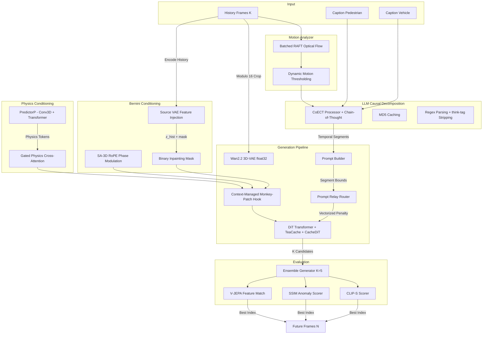

# WTS 2026 Challenge - Track 5: Generative Traffic Video Forecasting

This repository contains our team's solution for the **WTS 2026 Challenge Track 5: Generative Traffic Video Forecasting**. 
The goal of this track is to generate a sequence of realistic future traffic frames conditioned on a short history of observed frames and textual descriptions of pedestrian and vehicle behavior.

## Core Architecture

Our solution builds upon the state-of-the-art **Wan2.2 (TI2V-5B)** Video Diffusion architecture, fundamentally re-engineered to tackle Multi-Agent Traffic Dynamics with SOTA ideas from **Bernini** (arXiv:2605.22344) and **PhysVideoGenerator** (arXiv:2601.03665).

> [!NOTE]  
> **CoECT Paper Alignment & Adaptation**:
> While the original **CoECT** (arXiv:2603.09094) decomposes prompts purely via text-based LLM physical reasoning, it lacks visual grounding for video forecasting. To adapt CoECT for **WTS Track 5**, we developed a **hybrid CV-LLM pipeline**: we extract real-world motion vectors from the history frames $H$ using RAFT Optical Flow & Dynamic Motion Thresholding, translate them into text, and feed them into the CoECT reasoning prompt. This grounds the LLM reasoning in the actual visual history, preventing physics hallucinations.

> [!IMPORTANT]
> **Bernini & PhysVideoGen Integration**:
> We incorporate two cutting-edge ideas: **(1) SA-3D RoPE** (Segment-Aware 3D Rotary Position Embedding) disambiguates history/pedestrian/vehicle tokens sharing the same (t,h,w) coordinates via learnable phase offsets. **(2) Source VAE Feature Injection** (Latent Inpainting) encodes all K history frames into latent space and concatenates them with the noisy latent via a binary inpainting mask. **(3) PredictorP + Physics Cross-Attention** predicts V-JEPA 2 physics tokens from the noisy latent and injects them into every 4th DiT block via gated cross-attention, ensuring physical consistency (gravity, velocity, TTC).

We abandoned standard pixel-space composition and naive temporal concatenation in favor of a mathematically rigorous **Latent-Space Control Pipeline**.



## Directory Structure

```text
D:\TRACK5\
├── configs/
│   └── pipeline.yaml         # Master configuration (all hyperparams)
├── run_inference.py          # End-to-end inference script
├── test_integration.py       # API contract verification (8 tests)
├── data/
│   └── wts_dataset.py        # Modulo 16 VAE-safe Dataloader
├── evaluation/               # WTS evaluation metrics
├── inference/
│   ├── ensemble.py           # Multi-Candidate Generator & Scorers
│   └── inference.yaml        # Inference configurations
├── models/
│   ├── bernini_modules.py    # SA-3D RoPE + Source VAE Injection (arXiv:2605.22344)
│   ├── physics_predictor.py  # PredictorP + Physics Cross-Attention (arXiv:2601.03665)
│   ├── tiv2_pipeline.py      # DualModelPipeline + Deep Hooking + TeaCache + CacheDiT
│   ├── train.py              # LoRA Fine-Tuning (Flow-Matching Velocity Loss)
│   └── lora_finetune.yaml    # Training configurations
├── postprocess/              # Post-generation upscaling/filtering
├── prompt/
│   ├── coect_processor.py    # LLM Causal Chain Extractor (Bernini CoT + DeepSeek-R1)
│   ├── prompt_builder.py     # Prompt Optimizer (Token Dilution prevention)
│   └── prompt_relay.py       # Cross-Attention DiT Hook (arXiv:2604.10030)
└── utils/
    └── motion_analyzer.py    # Padding-Safe Batched RAFT Flow
```

## Key Technical Ideas

### 1. Bernini SA-3D RoPE (arXiv:2605.22344)
Segment-Aware 3D Rotary Position Embedding applies learnable phase offsets to distinguish between history frames (seg=1), target frames (seg=0), pedestrian tokens (seg=2), and vehicle tokens (seg=3). This prevents attention identity ambiguity when tokens share the same (t,h,w) coordinates.

### 2. Source VAE Feature Injection (Latent Inpainting)
All K history frames are encoded by the Wan2.2 VAE (float32), padded to match the target temporal length, and concatenated with the noisy latent along the channel dimension. A binary inpainting mask (1=known, 0=future) is appended. A Conv3D projection (2C+1 → C) restores the model's channel dimension. Zero-initialized for safe integration into pre-trained models.

### 3. PhysVideoGenerator PredictorP (arXiv:2601.03665)
A lightweight 4-layer Transformer predicts V-JEPA 2 physics tokens directly from the noisy latent. These tokens are injected via **Gated Cross-Attention** (zero-initialized gate) into every 4th DiT block, ensuring physical consistency without degrading pre-trained quality.

### 4. Context-Managed Deep Hooking
Since `diffusers` encapsulates the denoising loop, we use a `contextlib.contextmanager` to safely monkey-patch `pipe.transformer.forward` and individual DiT block `.forward` methods. All patches are automatically restored in the `finally` block, preventing memory leaks across 2,295 WTS clips.

### 5. CoECT + Chain-of-Thought Planning
CoECT decomposes traffic captions into causal temporal segments. With Bernini-inspired CoT, we allow LLMs (Claude/DeepSeek-R1/Qwen) to reason inside `<think>` tags before producing JSON. Our regex parser strips these tags automatically.

## Setup & Usage

### Requirements
```bash
pip install -r requirements.txt
```

Key dependencies:
- `torch >= 2.4.0`
- `diffusers >= 0.33.0`
- `transformers`, `peft`, `open_clip_torch`
- `anthropic` or `openai` (for CoECT LLM backend)

### Inference
```bash
python run_inference.py
```

### LoRA Fine-Tuning
```bash
python models/train.py
```

### Integration Tests
```bash
python test_integration.py
```

---

## 🐛 Bug Fix Ledger (Technical Report)

During development, we identified and resolved several critical vulnerabilities in the standard implementations of Video Diffusion and Prompt Relay.

### 1. The Linear Causal Chain Fallacy (CoECT)
* **Risk**: High (Semantic Hallucination)
* **Issue**: The original CoECT model asked the LLM for `elementary_events`, forcing it to split simultaneous pedestrian and vehicle actions into sequential chunks (e.g., Pedestrian moves 0-40%, Vehicle brakes 40-100%).
* **Fix**: Restructured the LLM prompt to mandate `temporal_segments`, forcing the LLM to explicitly fuse parallel actors into the same spatial-temporal window.

### 2. Prompt Relay VRAM Bomb & State Leaks
* **Risk**: Critical (OOM Crash & GPU Memory Leak)
* **Issue**: The DiT hook used an empty `__exit__` function and leaked closure state, causing `double-patching`. Furthermore, an unvectorized Python token loop bottlenecked the GPU, and intercepting Self-Attention ($K=Q$) caused a 9GB tensor allocation.
* **Fix**: Implemented `make_patched_forward` closures, `_original_forwards` state storage, vectorized PyTorch broadcast math, and a $K == Q$ Self-Attention safety lock.

### 3. VAE Misalignment & Rounding Gap
* **Risk**: High (Dimension Mismatch)
* **Issue**: Segment boundary calculation used `math.ceil`, which misaligned with the Wan2.2 VAE output shape. Fractional lengths dumped all rounding error onto the final segment.
* **Fix**: Implemented the precise `((N-1)//4) + 1` Diffusers 3D-VAE stride formula, and utilized a Cumulative Sum accumulator to evenly distribute fractional bounds.

### 4. The VAE Modulo 16 Crash
* **Risk**: Critical (Inference Crash)
* **Issue**: Wan2.2 requires spatial dimensions $(H, W)$ to be completely divisible by 16. WTS video crops can be arbitrary.
* **Fix**: Implemented `(H // 16) * 16` modulo cropping dynamically in `frames_to_tensor` in `wts_dataset.py`.

### 5. The Temporal Dilution Metric Bug
* **Risk**: Medium (Selection Bias)
* **Issue**: `TemporalCoherenceScorer` penalized high-speed videos because it averaged SSIM frame-to-frame.
* **Fix**: Converted to an SSIM Anomaly Detector (`broken_frames_ratio`), allowing fast-moving trajectories to score `1.0` while dropping points only for structural `SSIM < 0.65` glitches.

### 6. OpenAI/vLLM & DeepSeek-R1 Parser Compatibility
* **Risk**: High (JSON Parsing Error)
* **Issue**: Custom Reasoning Models (like DeepSeek-R1 or Qwen2.5-Max) emit `<think>...</think>` logs, containing brackets `{}` that cause standard JSON regex parsers to fail.
* **Fix**: Upgraded `CoECTProcessor` to support an `openai_compatible` backend. Added automatic `<think>` tag stripping and regex sanitization before parsing final JSON segments.

### 7. Flow-Matching Loss Mathematics
* **Risk**: High (Model Convergence Bottleneck)
* **Issue**: Standard trainers target raw noise ($\epsilon$), but Wan2.2 utilizes `FlowMatchEulerDiscreteScheduler`. Standard noise matching causes slow convergence.
* **Fix**: Mathematically updated `models/train.py` loss calculation to target the Continuous Flow velocity vector: `target = noise - latents`.

### 8. Python Module Shadowing & Import Errors
* **Risk**: Critical (Runtime Import Crash)
* **Issue**: Running `inference.py` directly caused namespace shadow conflict (module name shadowed package). Some internal imports also had invalid `src.` prefixes.
* **Fix**: Relocated script to the root directory as `run_inference.py`, corrected imports in `prompt_builder.py`, and added a mock class fallback for `WanPipeline` to guarantee compile stability without pre-installed environment dependencies.
