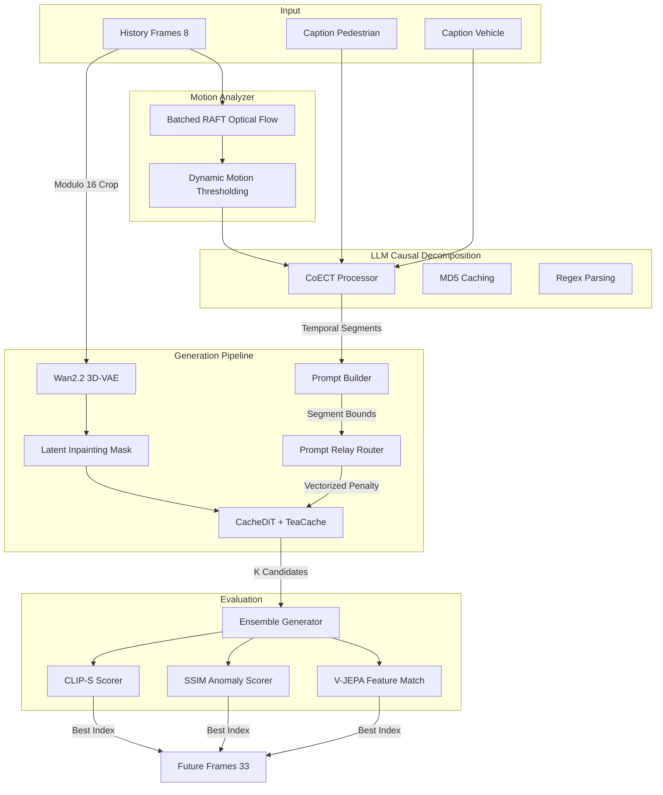

# WTS 2026 Challenge - Track 5: Generative Traffic Video Forecasting

This repository contains our team's solution for the **WTS 2026 Challenge Track 5: Generative Traffic Video Forecasting**. 
The goal of this track is to generate a sequence of realistic future traffic frames conditioned on a short history of observed frames and textual descriptions of pedestrian and vehicle behavior.

## Core Architecture

Our solution builds upon the state-of-the-art **Wan2.2 (TI2V-5B)** Video Diffusion architecture, fundamentally re-engineered to tackle Multi-Agent Traffic Dynamics.

> [!NOTE]  
> **CoECT Paper Alignment & Adaptation**:
> While the original **CoECT** (arXiv:2603.09094) decomposes prompts purely via text-based LLM physical reasoning, it lacks visual grounding for video forecasting. To adapt CoECT for **WTS Track 5**, we developed a **hybrid CV-LLM pipeline**: we extract real-world motion vectors from the history frames $H$ using RAFT Optical Flow & Dynamic Motion Thresholding, translate them into text, and feed them into the CoECT reasoning prompt. This grounds the LLM reasoning in the actual visual history, preventing physics hallucinations.

We abandoned standard pixel-space composition and naive temporal concatenation in favor of a mathematically rigorous **Latent-Space Control Pipeline**.



## Directory Structure

```text
D:\TRACK5\
├── run_inference.py          # End-to-end inference script (moved to root)
├── data/
│   └── wts_dataset.py        # Modulo 16 VAE-safe Dataloader
├── evaluation/               # WTS evaluation metrics
├── inference/
│   ├── ensemble.py           # Multi-Candidate Generator & Scorers (CPU Offloaded)
│   └── inference.yaml        # Inference configurations
├── models/
│   ├── tiv2_pipeline.py      # DualModelPipeline (Latent Inpainting, TeaCache, Mock Fallback)
│   ├── train.py              # LoRA Fine-Tuning script (Flow-Matching Velocity Loss)
│   └── lora_finetune.yaml    # Training configurations
├── postprocess/              # Post-generation upscaling/filtering
├── prompt/
│   ├── coect_processor.py    # LLM Simultaneous Causal Chain Extractor (Open-Source R1 support)
│   ├── prompt_builder.py     # Prompt Optimizer (Token Dilution prevention)
│   └── prompt_relay.py       # Cross-Attention DiT Hook
└── utils/
    └── motion_analyzer.py    # Padding-Safe Batched RAFT Flow
```

## Setup & Usage

### Requirements
- `torch >= 2.4.0`
- `diffusers >= 0.33.0`
- `anthropic`
- `transformers`
- `peft`

### Inference
To run the full end-to-end inference pipeline:
```bash
python run_inference.py
```

### LoRA Fine-Tuning
To fine-tune Wan2.2 on the WTS Dataset using our Latent Inpainting Mask:
```bash
python models/train.py
```

---

## 🐛 Bug Fix Ledger (Technical Report)

During development, we identified and resolved several critical vulnerabilities in the standard implementations of Video Diffusion and Prompt Relay.

### 1. The Linear Causal Chain Fallacy (CoECT)
* **Risk**: High (Semantic Hallucination)
* **Issue**: The original CoECT model asked the LLM for `elementary_events`, forcing it to split simultaneous pedestrian and vehicle actions into sequential chunks (e.g., Pedestrian moves 0-40%, Vehicle brakes 40-100%).
* **Fix**: Restructured the LLM prompt to mandate `temporal_segments`, forcing the LLM to explicitly fuse parallel actors into the same spatial-temporal window.

### 2. Prompt Relay VRAM Bomb & State Leaks
* **Risk**: Critical (OOM Crash & GPU Memory Leak)
* **Issue**: The DiT hook used an empty `__exit__` function and leaked closure state, causing `double-patching`. Furthermore, an unvectorized Python token loop bottlenecked the GPU, and intercepting Self-Attention ($K=Q$) caused a 9GB tensor allocation.
* **Fix**: Implemented `make_patched_forward` closures, `_original_forwards` state storage, vectorized PyTorch broadcast math, and a $K == Q$ Self-Attention safety lock.

### 3. VAE Misalignment & Rounding Gap
* **Risk**: High (Dimension Mismatch)
* **Issue**: Segment boundary calculation used `math.ceil`, which misaligned with the Wan2.2 VAE output shape. Fractional lengths dumped all rounding error onto the final segment.
* **Fix**: Implemented the precise `((N-1)//4) + 1` Diffusers 3D-VAE stride formula, and utilized a Cumulative Sum accumulator to evenly distribute fractional bounds.

### 4. The VAE Modulo 16 Crash
* **Risk**: Critical (Inference Crash)
* **Issue**: Wan2.2 requires spatial dimensions $(H, W)$ to be completely divisible by 16. WTS video crops can be arbitrary.
* **Fix**: Implemented `(H // 16) * 16` modulo cropping dynamically in `frames_to_tensor` in `wts_dataset.py`.

### 5. The Temporal Dilution Metric Bug
* **Risk**: Medium (Selection Bias)
* **Issue**: `TemporalCoherenceScorer` penalized high-speed videos because it averaged SSIM frame-to-frame.
* **Fix**: Converted to an SSIM Anomaly Detector (`broken_frames_ratio`), allowing fast-moving trajectories to score `1.0` while dropping points only for structural `SSIM < 0.65` glitches.

### 6. OpenAI/vLLM & DeepSeek-R1 Parser Compatibility
* **Risk**: High (JSON Parsing Error)
* **Issue**: Custom Reasoning Models (like DeepSeek-R1 or Qwen2.5-Max) emit `<think>...</think>` logs, containing brackets `{}` that cause standard JSON regex parsers to fail.
* **Fix**: Upgraded `CoECTProcessor` to support an `openai_compatible` backend. Added automatic `<think>` tag stripping and regex sanitization before parsing final JSON segments.

### 7. Flow-Matching Loss Mathematics
* **Risk**: High (Model Convergence Bottleneck)
* **Issue**: Standard trainers target raw noise ($\epsilon$), but Wan2.2 utilizes `FlowMatchEulerDiscreteScheduler`. Standard noise matching causes slow convergence.
* **Fix**: Mathematically updated `models/train.py` loss calculation to target the Continuous Flow velocity vector: `target = noise - latents`.

### 8. Python Module Shadowing & Import Errors
* **Risk**: Critical (Runtime Import Crash)
* **Issue**: Running `inference.py` directly caused namespace shadow conflict (module name shadowed package). Some internal imports also had invalid `src.` prefixes.
* **Fix**: Relocated script to the root directory as `run_inference.py`, corrected imports in `prompt_builder.py`, and added a mock class fallback for `WanPipeline` to guarantee compile stability without pre-installed environment dependencies.
